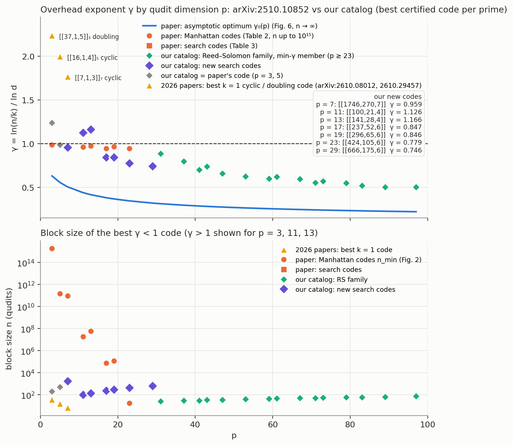

# Best certified code per prime, p <= 97

*2026-10-28. One row per prime: the lowest-gamma code in the catalog (`qmsd/data/catalog/`) with a
certified or closed-form distance, and the structural reason the row cannot be improved where we
have one. gamma = ln(n/k)/ln d.*

| p | best code | gamma | distance evidence | status / why |
|---|---|---|---|---|
| 3 | [[206,37,4]]_3 (paper's puncture set, A_d 572 ours) | 1.239 | MITM exact | gamma < 1 impossible for unweighted RM (flat cap); weighted m <= 7 probed, no window (`WEIGHTED_SUPPORTS.md`) |
| 5 | [[519,106,5]]_5 (paper) | 0.987 | MITM exact (10 s) | the only p <= 13 crossing; Singleton-infeasible at m <= 3 |
| 7 | [[1746,270,7]]_7 (weighted sphere, sweep seed 19, d = 7 exact, 2026-10-30); also [[1751,265,7]]_7 (0.970, exact), [[1756,260,7]]_7 (0.982, exact), [[1746,270,>=7]]_7 (seed 407, gamma <= 0.959, d = 7 or 8) | 0.959 | block weight-6 scan + mixed-word exclusion (+ full weight-5 cross-check for seed 19) and an explicit planar weight-7 word | three certified gamma < 1 codes at p = 7; certificates in CERTIFY_P7.md |
| 11 | [[100,21,4]]_11 (ours, m = 2 flat-spread search) | 1.126 | MITM exact | equals the 2D-cap prediction of the no-go; weighted supports dead by line words (r < p-1) |
| 13 | [[141,28,4]]_13 (ours, m = 2 search; [[147,22,5]]_13 at 1.180) | 1.166 | MITM exact | 2D-cap prediction is [[143,26,5]] (1.059); 150 trials/k found d = 4 at k = 26, d = 5 only at k = 22 |
| 17 | [[237,52,6]]_17 (ours) | 0.847 | MITM exact, two-way | first small gamma < 1 search code; 330x smaller than the analytic family |
| 19 | [[296,65,6]]_19 (ours, m = 2 line-spread sweep, 2026-10-28; was [[293,68,5]]_19 at 0.908) | 0.846 | no weight <= 5 (MITM) + explicit weight-6 line word | 6 of 6 draws at k = 62 and 5 of 6 at k = 65 (<= 7 outputs per line) give d = 6; all 6 draws at k = 68 fail (d = 4 or 5, accidental words as the random-count model predicts), so k = 65 is the limit |
| 23 | [[424,105,6]]_23 (ours, m = 2 line-spread sweep, 2026-10-29; also [[429,100,6]]_23 at 0.813); RS [[18,5,4]]_23 at 0.924 | 0.779 | no weight <= 5 (MITM, 1 h) + explicit weight-6 line word | first m = 2 codes at p = 23: all 180 line-spread draws at k = 90-110 have line distance exactly 6; k = 105 leaves 15 residual checks, the accidental-word limit (k = 110 is model-dead); RS m = 1 family (closed form) is the small-n alternative |
| 29 | [[666,175,6]]_29 (ours, m = 2 line-spread sweep, 2026-10-30); RS [[22,7,4]]_29 at 0.826 | 0.746 | no weight <= 5 (MITM, 24 h at 4 throttled threads) + explicit weight-6 line word | first m = 2 code at p = 29; k = 175 leaves 15 residual checks (the accidental-word limit) |
| 31 | [[25,6,5]]_31 | 0.887 | MITM exact; eps* = 0.416 | |
| 37 | [[29,8,5]]_37 | 0.800 | MITM exact; eps* = 0.383 | |
| 41 | [[31,10,5]]_41 | 0.703 | MITM exact; eps* = 0.371 | |
| 43 | [[34,9,6]]_43 | 0.742 | closed-form MDS | MITM tables scale as (p-1)^3: infeasible from here |
| 47 | [[36,11,6]]_47 | 0.662 | closed-form MDS | |
| 53 | [[40,13,6]]_53 | 0.627 | closed-form MDS | |
| 59 | [[45,14,7]]_59 | 0.600 | closed-form MDS | |
| 61 | [[47,14,7]]_61 | 0.622 | closed-form MDS | |
| 67 | [[51,16,7]]_67 | 0.596 | closed-form MDS | |
| 71 | [[53,18,7]]_71 | 0.555 | closed-form MDS | |
| 73 | [[56,17,8]]_73 | 0.573 | closed-form MDS | |
| 79 | [[60,19,8]]_79 | 0.553 | closed-form MDS | |
| 83 | [[62,21,8]]_83 | 0.521 | closed-form MDS | |
| 89 | [[67,22,9]]_89 | 0.507 | closed-form MDS | |
| 97 | [[73,24,9]]_97 | 0.506 | closed-form MDS | |

Notes.

- The RS rows are the minimum-gamma member of the family at each prime (`scratchpad/rs_family.py`,
  bundle `runs/coverage/rs_family_p23_97.json`); every k is admissible and the distance does not
  depend on which columns are punctured. Exact single-round thresholds (arXiv:2610.08012 model) are
  stored for p <= 41 (`qmsd/data/performance/`).
- p = 11 and 13 rows come from the m = 2 flat-spread search on loranne (`runs/coverage/p1[13]_m2_k*.json`,
  150 trials at each of 8-9 values of k, all imported), the first cataloged codes at those primes. The no-go
  (`D_NEGATIVE_RESULT.md`) predicts the 2D cap [[100,21,4]]_11 (gamma 1.126, reached) and [[143,26,5]]_13
  (gamma 1.059, not reached: d = 4 at k = 26 in 150 trials).
- The analytic Manhattan family (astronomical n) is cataloged separately and is not a "small code".

## Acceptance probability of the large codes

Exact enumeration is out of reach for the large codes (stabiliser spaces of dimension 10-66), but the
acceptance probability is a common event and Monte Carlo resolves it in minutes
(`scratchpad/pacc_mc.py`, `runs/certify/pacc_mc.json`, 2-4 x 10^5 shots per point). For every code the
sampled P_acc agrees with the no-error probability (1 - eps)^n to within 1% at eps = 10^-4 .. 10^-2:
accidental acceptance of a nonzero error is an O(A_d eps^d) correction and invisible at these rates.

| code | n | P_acc(1e-2) | P_acc(3e-3) | P_acc(1e-3) | P_acc(3e-4) | P_acc(1e-4) |
|---|---|---|---|---|---|---|
| [[237,52,6]]_17 | 237 | 0.094 | 0.49 | 0.79 | 0.93 | 0.98 |
| [[296,65,6]]_19 | 296 | 0.052 | 0.41 | 0.74 | 0.91 | 0.97 |
| [[424,105,6]]_23 | 424 | 0.014 | 0.28 | 0.66 | 0.88 | 0.96 |
| [[1756,260,7]]_7 | 1756 | < 1e-5 | 0.005 | 0.17 | 0.59 | 0.84 |
| [[1746,270,>=7]]_7 | 1746 | < 1e-5 | 0.005 | 0.18 | 0.59 | 0.84 |

Reading: a block of n qudits accepts roughly when it sees no error at all, so a code is usable only
once n x eps is of order one. The p = 7 codes (n ~ 1750) are second- or third-round codes, fed by a
small first round that brings eps to ~10^-4; the p >= 17 codes (n ~ 250-450) can take raw states at
eps ~ 10^-3. This is the regime the protocol optimizer already uses (e.g. [[7,1,3]]_7 -> [[1746,270,6]]_7).

## Comparison with arXiv:2510.10852 (Figures 2 and 6)

`runs/coverage/gamma_vs_p.png` (`scratchpad/gamma_vs_p_plot.py`). Top: the paper's asymptotic
optimum gamma_0(p) (its Figure 6 / Table 1; our `qmsd asymptotic` reproduces every tabulated value
to 5 digits and extends it to p = 97), the paper's finite codes (Table 2 Manhattan family, Table 3
search codes), the best k = 1 code per prime from the 2026 cyclic (arXiv:2610.08012) and doubling
(arXiv:2610.29457) papers ([[37,1,5]]_3 2.24, [[16,1,4]]_5 2.00, [[7,1,3]]_7 1.77: those papers optimise
length and cost at a single output, not gamma), and our catalog's best code per prime. Bottom: block
sizes (the paper's Figure 2).

| p | paper's best finite code | gamma | n | ours | gamma | n |
|---|---|---|---|---|---|---|
| 3 | [[206,37,4]]_3 (Table 3) / Manhattan | 1.239 / 0.990 | 206 / 1.9e15 | same code (A_d 572 vs 880) | 1.239 | 206 |
| 5 | [[519,106,5]]_5 (Table 3) / Manhattan | 0.987 / 0.980 | 519 / 1.5e11 | same code | 0.987 | 519 |
| 7 | Manhattan | 0.990 | 9.6e10 | [[1756,260,7]]_7 | 0.982 | 1756 |
| 11 | Manhattan | 0.964 | 1.9e7 | [[100,21,4]]_11 | 1.126 | 100 |
| 13 | Manhattan | 0.975 | 6.1e7 | [[141,28,4]]_13 | 1.166 | 141 |
| 17 | Manhattan | 0.946 | 77540 | [[237,52,6]]_17 | 0.847 | 237 |
| 19 | Manhattan | 0.967 | 121470 | [[293,68,5]]_19 | 0.908 | 293 |
| 23 | [[17,6,3]]_23 (RS) | 0.948 | 17 | [[18,5,4]]_23 (RS) | 0.924 | 18 |
| 29 | (RS family cited) | | | [[666,175,6]]₂₉ (m = 2 search); RS 0.826 | 0.746 | 666 |
| 31-97 | (RS family cited, not tabulated) | | | RS min-gamma member (p = 31 m = 2 certificate pending) | 0.887 -> 0.506 | 25 -> 73 |

Reading. (i) Every finite code, theirs or ours, sits far above gamma_0(p): the asymptotic curve is
an n -> infinity statement, and at p = 7 the gap is 0.98 vs 0.51. (ii) Where we have new codes
(p = 7, 17, 19) we beat the paper's Manhattan gamma at block sizes 10^3 to 10^8 times smaller; at
p = 11 and 13 we do not cross 1 at all (the flat cap), while the paper crosses only with n ~ 10^7.
(iii) From p = 23 the RS family is the whole story and gamma falls to 0.5 by p = 97 with n <= 73;
the paper lists only the p = 23 member. (iv) p = 3 is unchanged from the paper in gamma; our
contribution there is A_d and the exact performance engine.
